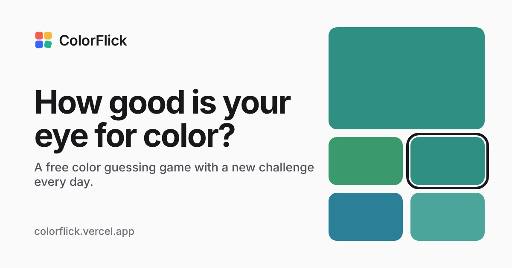

# ColorFlick

**A free color guessing game for people who love playing with colors.**

🎨 Play it at **[colorflick.vercel.app](https://colorflick.vercel.app)**



## Why this project exists

ColorFlick is a **just-for-fun platform for anyone who enjoys colors** — designers training their
eye, developers who want to read hex codes at a glance, students learning color theory, or anyone
looking for a relaxing daily puzzle.

There are no accounts, no ads and no paywalls. Open the page and play. Your scores, streaks and
achievements are stored only in your own browser.

## What you can do

**Play — nine game modes, four difficulty levels**

| Mode | What you do |
| --- | --- |
| Color guessing game | Find the swatch that exactly matches the target |
| RGB mixer | Recreate a color with red, green and blue sliders |
| HEX code | Look at a color and type its hex code |
| HSL matcher | Match a color with hue, saturation and lightness sliders |
| Color picker | Recreate a color by eye with a color picker |
| Color name | Pick the right name for a color |
| Warm or cool | Sort colors into warm, cool or neutral |
| Light or dark | Decide whether a color is light or dark |
| Closest color | Pick the swatch that looks nearest to the target |

Formats: standard (10 rounds), quick challenge (gets harder as you go), timed, endless, survival
and practice.

**Daily challenge** — ten rounds that are the same for everyone each day, a daily streak, a
spoiler-free result grid to share (🟩🟩🟥🟩…), a countdown to the next puzzle, and a calendar to
replay the last five weeks.

**Your progress** — accuracy over your recent games, which color families you find hardest, and
16 achievements to unlock.

**Color tools** — a HEX/RGB/HSL converter, a WCAG contrast checker, an OKLab color-difference
calculator and a list of named web colors.

**Learn** — short guides to color theory, RGB, HEX and HSL.

### Fair by design

- Closeness is measured in **OKLab**, a color space built around human vision, so a near miss is
  scored as a near miss.
- In every round, every wrong swatch is **guaranteed to be visibly different** from the target and
  from the other swatches — even on Expert. This is covered by automated tests.
- Right and wrong answers are always shown with an icon and a label, never by color alone, and
  there are color-blind and high-contrast settings.

## Run it locally

You need [Node.js](https://nodejs.org/) 18 or newer (20+ recommended).

```bash
git clone https://github.com/shoaibmarif/colorflick.git
cd colorflick
npm install
npm run dev
```

Then open <http://localhost:3000>.

### Scripts

| Command | What it does |
| --- | --- |
| `npm run dev` | Start the development server with hot reload on port 3000 |
| `npm run build` | Type-check and build the production site into `dist/` |
| `npm run preview` | Serve the production build locally on port 4173 |
| `npm test` | Run the test suite (Vitest) |

The production build also pre-renders an HTML page for every route with its own title,
description and social-preview tags, and generates `sitemap.xml`, `robots.txt` and `404.html`.

## Project structure

```text
src/
  pages/            One component per page (home, games, tools, guides, about…)
  components/       UI building blocks (layout, game board, swatches, charts…)
  hooks/            Game engine, daily challenge, settings and stats state
  utils/            Color math (conversion, OKLab distance, luminance), scoring, sharing
  data/             FAQ, achievements, color names, mode guides
  seo/              Site config, per-page SEO metadata, structured data
  storage/          localStorage persistence and a tiny shared store
scripts/seoPlugin.ts  Build step that pre-renders pages and writes the sitemap
tests/              Unit tests and a render test for every page
vercel.json         Hosting config: clean URLs, redirects, caching headers
```

Useful places to start:

- **Brand name, domain and links:** `src/seo/site.ts`
- **Page titles and descriptions:** `src/seo/routes.ts`
- **Difficulty settings (number of swatches, how close they are):** `DIFFICULTY_CONFIGS` in
  `src/utils/randomColor.ts`
- **Scoring rules:** `SCORING` in `src/utils/scoring.ts`

## Tech stack

React 19 · TypeScript · Vite · Tailwind CSS · React Router · Vitest. Hosted on Vercel.

## Deploying

The site deploys to Vercel with no extra setup: import the repository, and Vercel picks up the
build command and output folder from `vercel.json`. If you use a different domain, change `url`
in `src/seo/site.ts` — canonical URLs, the sitemap and social tags all follow from it.

## Contributing

Ideas for new modes, bug reports and pull requests are all welcome — please
[open an issue](https://github.com/shoaibmarif/colorflick/issues) first for anything big.
Run `npm test` and `npm run build` before sending a pull request.

## Author

Made by **Shoaib Arif**

- Portfolio: [shoaibarif.vercel.app](https://shoaibarif.vercel.app/)
- LinkedIn: [linkedin.com/in/shoaibmarif](https://www.linkedin.com/in/shoaibmarif/)
- GitHub: [@shoaibmarif](https://github.com/shoaibmarif)
- Email: [shoaibmuhammadarif@gmail.com](mailto:shoaibmuhammadarif@gmail.com)
